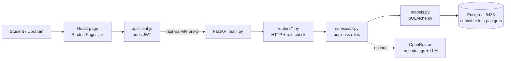

# Meeting Brief: Reading Room LMS (founder review)

Last analyzed: commit `2de3c13` plus uncommitted UI/catalog changes, 2026-10-22.

## In one sentence
A library system where students borrow books and librarians approve, return and fine them. Borrowing is gated by a trust score computed from the student's history, and an optional AI assistant finds books by meaning.

## Architecture (Observed)

## Borrow request trace (Observed)
1. `StudentPages.jsx:15` calls `api('/loans', {method:'POST', body:{book_id}})`
2. `api/client.js` adds `Authorization: Bearer <JWT>` and calls `fetch('/api/loans')`
3. `main.py` mounts the routers under `/api`, and `routers/loans.py:borrow` receives the request
4. `Depends(get_db)` opens a session from `db.py`, and `Depends(get_current_user)` decodes the JWT and checks that the session has not been logged out (`core/security.py`)
5. Pydantic `BorrowIn` validates the body (`book_id: int`), so bad input gets a 422 before any code runs
6. `loan_service.borrow` locks the student row, checks the loan limit and duplicates, computes trust, runs the atomic `UPDATE ... WHERE available_copies > 0`, inserts the Loan and the Activity row, then commits
7. `ServiceError` becomes `{"detail": ...}` JSON (`main.py` exception handler)
8. The router returns `BorrowOut`, and the response model controls which fields leave the server

## DB connection (Observed)
`.env` sets `LMS_DATABASE_URL`, `config.py` reads it into Settings (cached), `db.py` creates the engine (connection pool) and `SessionLocal`, and `get_db()` gives each request its own session and always closes it.

## Hands-on demo
- ORM X-ray (read-only, rolls back): `scratchpad/orm_xray.py` prints the SQL for `db.get`, relationships, `select().where`, the trust queries and the atomic UPDATE
- psql: `docker exec -it lms-postgres psql -U lms -d lms`, then `\dt`, `\d books`, `SELECT * FROM alembic_version;`

## Key decisions
| Decision | Why | Trade-off |
|---|---|---|
| Router → service → model layering | Rules testable without HTTP | More files |
| Trust score computed, not stored | Can never go stale | A few queries per borrow |
| Atomic UPDATE + CHECK constraint | Two users can't take the last copy | Stock logic lives partly in the DB |
| Row lock `FOR UPDATE` per student | Parallel requests can't bypass the limit (LMS-BUG-006) | Serialises one student's requests |
| `LMS_` env prefix | A foreign DATABASE_URL can't redirect the app (LMS-BUG-002) | Non-standard variable names |
| AI optional, keyword fallback | Works offline, free in tests | Two code paths |

## Open questions / risks
- No frontend tests
- No vector index (2048 dims is above pgvector's 2000 index limit), fine at the current catalog size
- Uncommitted UI work (Landing, Shelf) still has to be committed
