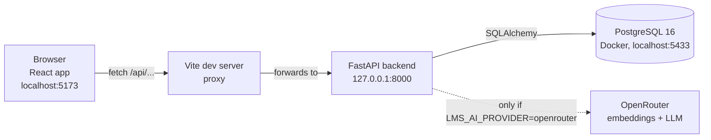
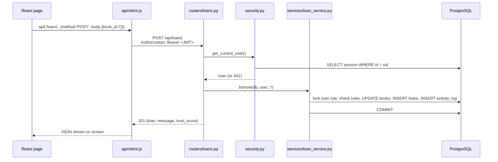
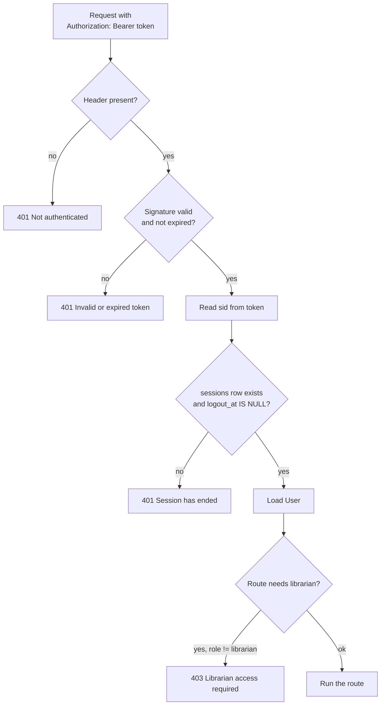
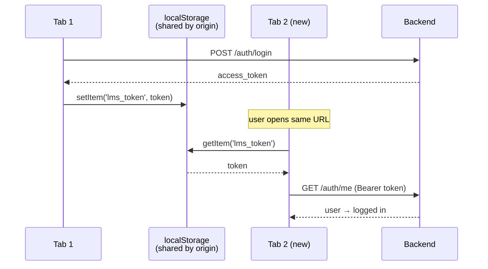
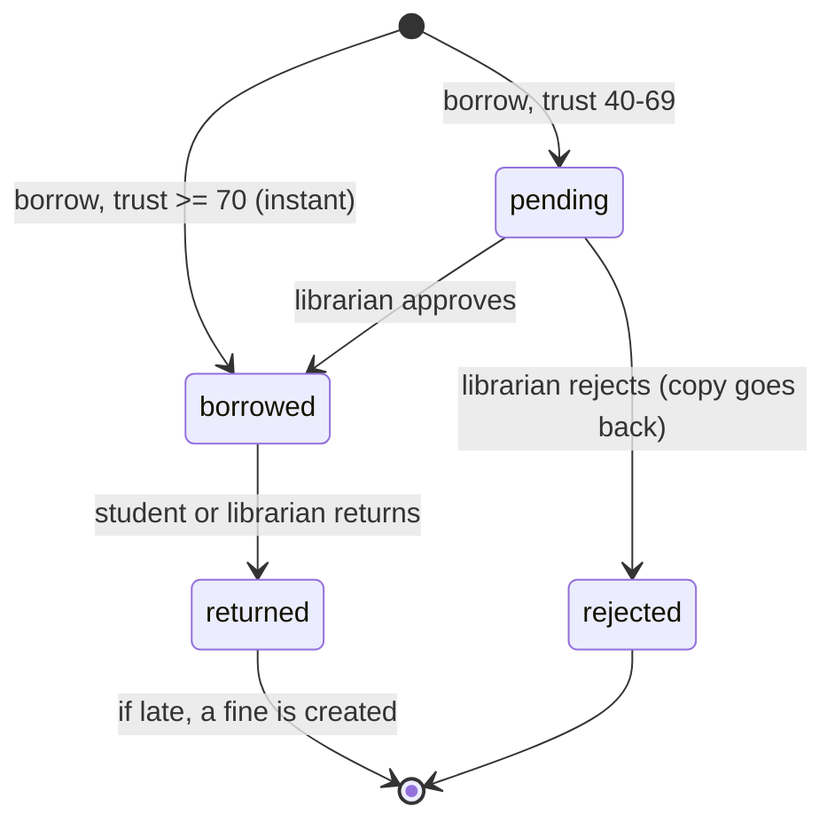

# How Reading Room Works: an intern's guide

This guide walks through the whole project from the browser down to the database. Every claim points to a file and line, so you can open the code and check it.

Contents:

1. [The big picture](#1-the-big-picture)
2. [What happens on a single request](#2-what-happens-on-a-single-request)
3. [How a REST API works (in this project)](#3-how-a-rest-api-works-in-this-project)
4. [Login, JWT and sessions](#4-login-jwt-and-sessions)
5. [Why a new tab is already logged in](#5-why-a-new-tab-is-already-logged-in)
6. [How data is stored: the tables](#6-how-data-is-stored-the-tables)
7. [Data entry and validation](#7-data-entry-and-validation)
8. [CRUD: create, read, update, delete](#8-crud-create-read-update-delete)
9. [Duplicates: how they are stopped](#9-duplicates-how-they-are-stopped)
10. [How deleting works (and why most things are never deleted)](#10-how-deleting-works-and-why-most-things-are-never-deleted)
11. [Borrowing, returning, fines and "payment"](#11-borrowing-returning-fines-and-payment)
12. [The trust score](#12-the-trust-score)
13. [Concurrency: two requests at the same time](#13-concurrency-two-requests-at-the-same-time)
14. [The audit log](#14-the-audit-log)
15. [The AI assistant (optional)](#15-the-ai-assistant-optional)
16. [Hands-on: see it working yourself](#16-hands-on-see-it-working-yourself)
17. [Questions your mentor might ask](#17-questions-your-mentor-might-ask)

---

## 1. The big picture



| Layer | Technology | Where |
|:--|:--|:--|
| Frontend | React 19 + Vite + Tailwind | `frontend/src/` |
| Backend | FastAPI (Python) | `backend/app/` |
| Database access | SQLAlchemy ORM | `backend/app/models.py`, `backend/app/db.py` |
| Schema changes | Alembic migrations | `backend/alembic/versions/` |
| Database | PostgreSQL 16 + pgvector, in Docker | `docker-compose.yml` |

There are two kinds of user (`backend/app/models.py:28`):

- **student**: browses books, borrows, returns, sees their own fines and trust score.
- **librarian**: manages books and categories, approves or rejects requests, marks fines paid, sees every student.

---

## 2. What happens on a single request

Example: a student clicks **Borrow** on a book.



Code moves through three layers, and each layer has one job:

| Layer | Job | Example |
|:--|:--|:--|
| **Router** (`routers/`) | HTTP only: read the request, check who is calling, call a service, shape the response | `routers/loans.py:24` |
| **Service** (`services/`) | Business rules: limits, trust, fines. Never imports FastAPI | `services/loan_service.py:35` |
| **Model** (`models.py`) | What the tables look like | `models.py:73` (Loan) |

When a rule is broken, the service raises `ServiceError(status, message)` (`services/errors.py:1`). `main.py:23` turns it into an HTTP response such as `409 {"detail": "Loan limit reached (3 active books). Return one first."}`.

---

## 3. How a REST API works (in this project)

REST means each **thing** (resource) gets a URL, and the **HTTP method** says what you want to do with it.

| Method | Meaning | Example in this app |
|:--|:--|:--|
| `GET` | Read, changes nothing | `GET /api/books?q=python` |
| `POST` | Create, or perform an action | `POST /api/books`, `POST /api/loans/5/return` |
| `PUT` | Replace or update | `PUT /api/books/7` |
| `DELETE` | Remove | `DELETE /api/categories/3` |

Status codes tell the client what happened:

| Code | Meaning | When you will see it here |
|:--|:--|:--|
| 200 | OK | Most reads and updates |
| 201 | Created | New book, new loan, registration |
| 204 | No content | Delete, logout |
| 400 | Bad request | Unknown category id on a book |
| 401 | Not logged in / token invalid | Missing token, expired token, logged-out session |
| 403 | Logged in but not allowed | A student calling a librarian endpoint |
| 404 | Not found | `GET /api/books/99999` |
| 409 | Conflict with existing data | Duplicate email, duplicate ISBN, no copies left |
| 422 | Validation failed | Password shorter than 8 characters (FastAPI + Pydantic) |

Every route is mounted under `/api` (`main.py:35-36`). The full list is in [`docs/API.md`](API.md). While the backend runs, interactive docs are at <http://127.0.0.1:8000/docs>, where you can call endpoints from the browser.

**Why there is no CORS problem in development:** the React app calls `/api/...` on its own origin (`localhost:5173`), and Vite forwards it to port 8000 (`frontend/vite.config.js`). The browser only ever talks to one origin.

---

## 4. Login, JWT and sessions

### 4.1 Passwords

Passwords are never stored as plain text. `hash_password` uses **bcrypt** with a random salt (`core/security.py:24-29`). At login, `verify_password` hashes the typed password and compares the two hashes. The response models never include `password_hash` (`schemas.py`, `UserOut`).

### 4.2 What happens when you log in

`POST /api/auth/login` (`routers/auth.py:31-48`):

1. Looks up the user by lowercased email.
2. Checks the password with bcrypt. If either is wrong, it returns `401 "Wrong email or password"`. The message doesn't say which one was wrong, so attackers can't use it to find valid emails.
3. **Inserts a row in the `sessions` table** with the IP and browser user-agent.
4. Writes an `auth.login` row to the audit log.
5. Returns a **JWT** plus the user and their previous session ("last login").

### 4.3 What is inside the JWT

A JWT is three base64 parts: `header.payload.signature`. Ours is built in `core/security.py:32-40`:

```json
{
  "sub": "4",                                   // user id
  "role": "student",
  "sid": "8f1c...-uuid",                        // the sessions row id
  "exp": 1760000000                             // expiry: now + LMS_JWT_EXPIRE_MINUTES (480 = 8 hours)
}
```

The signature is HMAC-SHA256 with `LMS_JWT_SECRET` from `.env`. Anyone can **read** the payload (paste a token into jwt.io), but nobody can **change** it without the secret, because the signature would no longer match. That's why secrets never go in a JWT.

### 4.4 How every request is checked

The router declares a dependency such as `user: User = Depends(get_current_user)`. FastAPI then runs this chain before your route code (`core/security.py:47-76`):



### 4.5 Why logout really works here

A plain JWT is *stateless*: the server just checks the signature, so a stolen token stays valid until it expires and "logout" only deletes it from the browser.

This project adds a check against the database. The token carries a session id (`sid`). `POST /api/auth/logout` sets `sessions.logout_at = now` (`routers/auth.py:51-56`), and step **E** above rejects any token whose session has ended. Logout therefore revokes the token on the server. The cost is one primary-key lookup per request, which is cheap.

---

## 5. Why a new tab is already logged in

This is your mentor's question. In short: **the token lives in `localStorage`, and every tab of the same origin shares one `localStorage`.**

### 5.1 Step by step

**Tab 1: you log in**

1. `Login.jsx` calls `login(email, password)` from `AuthContext.jsx:21`.
2. That POSTs to `/api/auth/login` and gets back `access_token`.
3. `tokenStore.set(token)` writes it to `localStorage["lms_token"]` (`api/client.js:2-8`).
4. React state `user` is set, and the student pages render.

**Tab 2: you open `http://localhost:5173` again**

1. The React app starts from scratch. React state is per tab and empty.
2. `AuthProvider` starts with `loading = !!tokenStore.get()`. A token exists, so it shows a loading state instead of the login page (`AuthContext.jsx:10`).
3. The `useEffect` calls `GET /api/auth/me` with that token (`AuthContext.jsx:14-19`).
4. The backend runs the section 4.4 chain: signature valid, session still open, so it returns the user.
5. `setUser(user)` runs, and you are logged in. You never typed a password.



### 5.2 The edge cases (good to mention)

| Situation | What happens | Why |
|:--|:--|:--|
| New tab, same URL | Logged in | Same origin, same localStorage |
| Close the browser and reopen | Still logged in, up to 8 hours | localStorage survives restarts; the token expires after `LMS_JWT_EXPIRE_MINUTES` |
| `localhost:5173` vs `127.0.0.1:5173` | **Not** logged in | Different host means a different origin, so a separate localStorage |
| Incognito/private window | Not logged in | Incognito has its own storage |
| A different browser | Not logged in | Each browser has its own storage |
| Log out in Tab 1, then click something in Tab 2 | Tab 2 goes back to the login page | Tab 2's next API call gets 401 because the session has ended; `client.js:31` calls the unauthorized handler, which clears the token and the user |
| Log out in Tab 1, Tab 2 left idle | Tab 2 *still looks* logged in until its next request | The app doesn't listen for the browser `storage` event. Adding `window.addEventListener('storage', ...)` in `AuthContext` would log out every tab instantly. This would be a nice small improvement for you to propose |
| Token expires | Next request returns 401, then you go back to the login page | `exp` check in `jwt.decode` |

### 5.3 localStorage vs cookies (a likely follow-up question)

| | localStorage (this project) | HttpOnly cookie |
|:--|:--|:--|
| Shared across tabs | Yes | Yes |
| JavaScript can read it | Yes, so an XSS bug could steal it | No |
| Sent automatically | No, `client.js` adds the header | Yes, so you need CSRF protection |

This project reduces the XSS risk by never rendering AI or user text as HTML. `components/RichText.jsx` builds React elements instead of using `innerHTML`.

---

## 6. How data is stored: the tables

Tables are defined in Python in `backend/app/models.py` and created in the real database by Alembic migrations (`backend/alembic/versions/`).

```mermaid
erDiagram
  users ||--o{ loans : borrows
  users ||--o{ fines : owes
  users ||--o{ sessions : "logs in"
  users ||--o{ activity_log : does
  categories ||--o{ books : contains
  books ||--o{ loans : "is lent in"
  loans ||--o| fines : "may create"

  users { int id PK; string name; string email UK; string password_hash; string role }
  categories { int id PK; string name UK; text description }
  books { int id PK; string title; string author; string isbn UK; int category_id FK; int total_copies; int available_copies; tsvector search; vector embedding }
  loans { int id PK; int user_id FK; int book_id FK; string status; timestamp due_at; timestamp returned_at }
  fines { int id PK; int loan_id FK_UK; int user_id FK; int days_late; int amount; string status }
  sessions { uuid id PK; int user_id FK; timestamp login_at; timestamp logout_at }
  activity_log { int id PK; int user_id FK; string action; string entity; jsonb details }
```

Rules the **database itself** enforces, even if the Python code had a bug:

| Rule | Where |
|:--|:--|
| Email is unique | `models.py:24` |
| Category name is unique | `models.py:34` |
| ISBN is unique (blank is allowed) | `models.py:43` |
| `role` is only `student` or `librarian` | `models.py:28` |
| `0 <= available_copies <= total_copies` | `models.py:67-68` |
| Loan status is pending/borrowed/returned/rejected | `models.py:87` |
| At most one fine per loan | `models.py:94` (`loan_id` unique) |
| Fine status is unpaid/paid/waived | `models.py:103` |
| A book must point to a real category | Foreign key `models.py:44` |

`books.search` is a **generated column**: Postgres rebuilds it whenever title, author or description changes (`models.py:51-59`). The app never writes to it.

### 6.1 How a session gets a database connection

`db.py:22-27`: every HTTP request gets its own SQLAlchemy `Session` from `get_db()`. The route uses it, and `finally: db.close()` returns the connection to the pool even if the request crashed. Nothing is saved until `db.commit()`. If an error happens before that, everything in the request is thrown away together. That is a **transaction**.

---

## 7. Data entry and validation

Data reaches the database three ways:

| Way | Who | How |
|:--|:--|:--|
| Web forms | Librarian adds books/categories; anyone registers | React form, then `api()`, then router |
| Seed script | Developer | `python -m scripts.seed` creates demo users, categories, books, loans and fines |
| Direct API calls | Testing | Swagger at `/docs`, curl, `scripts/smoke_api.py` |

Each request passes **three checks** in order:

1. **Shape check (Pydantic, `schemas.py`).** This runs before any of your code. Examples: name 2-120 characters, email must look like an email, password at least 8 characters (`schemas.py:16-19`); book `total_copies` 1-100 and `cover_color` must match `#RRGGBB` (`schemas.py:63-71`). A failure returns **422** with the field name.
2. **Business check (router/service code).** Examples: "category already exists", "no copies available", "loan limit reached". A failure returns **400/403/404/409**.
3. **Database constraints** (table in section 6). This is the last safety net.

Data is also **cleaned** on the way in:

- Emails are lowercased (`routers/auth.py:19, 33`), so `Asha@Library.dev` and `asha@library.dev` are one account.
- Names are trimmed (`routers/auth.py:23`, `routers/catalog.py:55`).
- Book tags are trimmed, lowercased and empty ones dropped (`routers/catalog.py:148`).
- Self-registration is **always** `role="student"` (`routers/auth.py:22-23`). You can't make yourself a librarian through the API.

---

## 8. CRUD: create, read, update, delete

Let's follow **books**, the clearest example (`routers/catalog.py`).

| Operation | Endpoint | Who | What the code does |
|:--|:--|:--|:--|
| **Create** | `POST /api/books` | Librarian | Check the category exists, then clean tags, set `available_copies = total_copies`, `INSERT`. A duplicate ISBN returns 409. Log `book.created`, then commit (`:144-159`) |
| **Read (list)** | `GET /api/books?q=&category_id=&available=` | Anyone logged in | Builds a `SELECT` with optional filters: title/author `ILIKE` **or** full-text match on `search` (`:105-124`) |
| **Read (one)** | `GET /api/books/{id}` | Anyone logged in | `SELECT ... WHERE id=`, or 404 (`:134-136`) |
| **Update** | `PUT /api/books/{id}` | Librarian | Refuses if the new total is lower than the copies currently on loan; otherwise recalculates `available = total - out_now`, then `UPDATE` (`:162-180`) |
| **Delete** | `DELETE /api/books/{id}` | Librarian | Refuses if the book was **ever** loaned; otherwise `DELETE` (`:183-190`) |

**Categories** have the same CRUD with their own rules (`routers/catalog.py:51-102`):

- Create/rename: names compare **case-insensitively**, so "Science" and "science" clash.
- Delete: only when the category has **zero books**.
- Rename: every book in that category gets re-embedded for AI search, because the category name is part of each book's searchable text.

### 8.1 Create, step by step, down to SQL

What `POST /api/books` with `{"title":"Dune","author":"Frank Herbert","category_id":2,"total_copies":3}` turns into:

```sql
BEGIN;
SELECT * FROM categories WHERE id = 2;                       -- _check_category
INSERT INTO books (title, author, category_id, total_copies, available_copies, tags, ...)
VALUES ('Dune', 'Frank Herbert', 2, 3, 3, '{}', ...) RETURNING id;   -- db.flush()
INSERT INTO activity_log (user_id, action, entity, entity_id, details)
VALUES (1, 'book.created', 'book', 41, '{"title": "Dune"}');
COMMIT;                                                       -- both rows saved together
```

`db.flush()` sends the INSERT so we get the new `id`, but nothing is permanent until `COMMIT`. If the activity insert failed, the book would be rolled back too.

---

## 9. Duplicates: how they are stopped

This project **does not delete duplicates after they are saved. It refuses to save them in the first place.** That's the safer design. "Clean up later" means that for some time the data was wrong, and you then have to guess which copy to keep, even though other rows may already point at the wrong one.

| What | Check in code | Backup in DB | Response |
|:--|:--|:--|:--|
| Same email registering twice | `routers/auth.py:20-21` | `users.email UNIQUE` | `409 Email already registered` |
| Same category name (any case) | `routers/catalog.py:53-54`, rename `:79-81` | `categories.name UNIQUE` | `409 Category already exists` |
| Same ISBN on two books | catches `IntegrityError` `:151-155`, `:174-178` | `books.isbn UNIQUE` | `409 A book with this ISBN already exists` |
| Borrowing a book you already have or requested | `services/loan_service.py:46-48` | (locked row, section 13) | `409 You already have this book...` |
| Two fines for one late loan | only created once on return | `fines.loan_id UNIQUE` | impossible by construction |

**Why both a code check *and* a DB constraint?** The code check gives the user a friendly message. The constraint catches the case where two requests arrive at the same instant: both pass the code check, but the database lets only one INSERT succeed. Never rely on the code check alone.

**What *is* allowed to repeat:** two books with the same **title**. Different editions, or a book with no ISBN, are legitimately separate rows. If your mentor wants "same title + author = duplicate", that's a new rule: add a unique index on `(lower(title), lower(author))` in a **new** Alembic migration, plus a 409 check in `create_book` / `update_book`.

### Try it

```bash
# Register the same email twice; the second call returns 409
curl -X POST http://127.0.0.1:8000/api/auth/register -H "Content-Type: application/json" \
  -d '{"name":"Test","email":"dup@x.dev","password":"Password@1"}'
curl -X POST http://127.0.0.1:8000/api/auth/register -H "Content-Type: application/json" \
  -d '{"name":"Test","email":"DUP@x.dev","password":"Password@1"}'   # uppercase still clashes
```

The test `test_category_full_crud` in `backend/tests/test_api.py` covers the duplicate-category case. Run it with
`.venv/Scripts/python -m pytest tests/test_api.py::test_category_full_crud -q` from `backend/`.

---

## 10. How deleting works (and why most things are never deleted)

| Data | Can it be deleted? | What happens instead |
|:--|:--|:--|
| Category | Yes, **only if it has no books** | Otherwise 409, "move or delete them first" |
| Book | Yes, **only if it was never loaned** | Otherwise 409. Set copies instead so loan history stays intact |
| Loan | **Never** | Status changes: `pending → borrowed → returned` or `pending → rejected` |
| Fine | **Never** | Status changes: `unpaid → paid` or `unpaid → waived` |
| Session | **Never** | `logout_at` is filled in |
| Activity log | **Never** | Append-only |
| User | No API for it | |

Why: a loan points to a book and a student, and a fine points to a loan. If you hard-deleted a book that had loans, those loans would point at nothing (Postgres would actually refuse because of the foreign key) and the student's history would vanish. Keeping the rows and changing a **status** is called a *soft* lifecycle, and it keeps the history honest.

A real delete (`routers/catalog.py:183-190`):

```python
book = _get_book(db, book_id)                         # 404 if missing
if db.scalar(select(func.count()).select_from(Loan).where(Loan.book_id == book_id)):
    raise HTTPException(409, "Book has loan history; ...")
activity.log(db, lib.id, "book.deleted", "book", book.id, title=book.title)   # who deleted what
db.delete(book)                                       # DELETE FROM books WHERE id = ...
db.commit()
```

The deletion is still recorded in `activity_log`, title included, so you can answer "who deleted this book?" later.

---

## 11. Borrowing, returning, fines and "payment"

### 11.1 Loan lifecycle



`borrow` (`services/loan_service.py:35-66`) checks, in order:

1. Only students can borrow (403).
2. The book exists (404).
3. Locks the student row (section 13).
4. The student doesn't already have this book (409).
5. Fewer than `LMS_MAX_ACTIVE_LOANS` (default 3) active loans (409).
6. Trust score isn't `blocked` (403).
7. Takes one copy atomically (409 if none left).
8. Creates the loan as `borrowed` (due in `LMS_LOAN_DAYS`, default 14) or `pending`.

A **pending** request already holds a copy, so approval can never fail for lack of stock. Rejecting puts the copy back (`loan_service.py:91-99`).

### 11.2 Fines

When a book is returned (`loan_service.py:102-118`):

```
days_late = return_date - due_date      (calendar days)
if days_late > 0:  fine = days_late × LMS_FINE_PER_DAY   (default Rs 5/day)
```

The fine is inserted **in the same transaction** as the return, so you can never end up with a returned book and a missing fine.

### 11.3 "Payment": what it is and isn't

**There is no online payment integration** (no Razorpay, Stripe, UPI or card handling) anywhere in the code. The flow is:

1. The student pays at the library counter (offline).
2. The librarian clicks **Paid** or **Waive**, which calls `POST /api/fines/{id}/pay` or `/waive` (`routers/loans.py:94-103`).
3. `fine_service.mark` (`services/fine_service.py:11-22`):
   - locks the fine row (`FOR UPDATE`) so two clicks can't both process it,
   - refuses if it isn't `unpaid` (`409 Fine is already paid`),
   - sets `status` and `paid_at`, and logs `fine.paid` with the amount.
4. The student's trust score rises at once, because unpaid fines are subtracted live (section 12).

Only librarians can mark payment. A student can't pay their own fine through the API.

If online payment is ever added, the usual pattern is: create a payment order with the gateway, then let the gateway call **your webhook** (server-to-server, verified by signature), and only the webhook marks the fine `paid`. Never trust the browser saying "payment succeeded". That would be new work, not something that exists today.

---

## 12. The trust score

`services/trust_service.py`. It is **computed fresh on every request and never stored**, so it can't go stale.

```
score = 100
        − 10 × late returns
        − 15 × unpaid fines
        − 25 if any book is overdue right now
        +  2 × on-time returns
clamped to 0..100
```

| Score | Level | Effect on borrowing |
|:--|:--|:--|
| ≥ 70 | `instant` | Loan starts immediately |
| 40-69 | `approval` | Loan is `pending` until a librarian decides |
| < 40 | `blocked` | 403, must return overdue books / pay fines |

The seed data builds one student at each level (see README demo logins: `asha`, `ravi`, `meera`, `kiran`). Log in as each and try borrowing to see all three behaviours.

---

## 13. Concurrency: two requests at the same time

Picture the last copy of a book and two students clicking Borrow in the same millisecond. A naive version reads `available = 1` for both, both subtract 1, and you end up at `-1`.

This project prevents that in three ways:

1. **Atomic update** (`loan_service.py:19-28`):
   ```sql
   UPDATE books SET available_copies = available_copies - 1
   WHERE id = :id AND available_copies > 0
   ```
   The check and the change happen in one statement. Only one request gets `rowcount = 1`; the other gets 0, which becomes `409 No copies available`.
2. **Row lock on the student** (`loan_service.py:42-44`). `SELECT ... FOR UPDATE` makes two requests from the *same* student wait in line, so the "3 book limit" and "already borrowed" checks can't both pass at once (history: `docs/BUG_FIXES.md`, LMS-BUG-006).
3. **Database CHECK** `available_copies >= 0`. Even if the code were wrong, Postgres refuses a negative count.

Loan approval and fine payment lock their row the same way, so two librarians can't approve the same request twice.

---

## 14. The audit log

Every write calls `activity.log(...)` before `commit` (`services/activity.py`), so the action and its audit row are saved together, or not at all.

Examples of `action` values: `user.registered`, `auth.login`, `auth.logout`, `book.created`, `book.updated`, `book.deleted`, `category.*`, `loan.borrowed`, `loan.pending`, `loan.approved`, `loan.rejected`, `loan.returned`, `fine.paid`, `fine.waived`.

Librarians see it at `GET /api/activity`; students see their own at `GET /api/activity/me`.

---

## 15. The AI assistant (optional)

Off by default (`LMS_AI_PROVIDER=none`), and then the app works fully offline with keyword search.

With `LMS_AI_PROVIDER=openrouter`:

1. **Embedding.** Each book's text (title, author, category, tags, description) becomes a 2048-number vector stored in `books.embedding`. A hash of the text means only changed books get re-embedded (`services/embedding_service.py`).
2. **Ask.** A student's question is embedded too. The app finds books by vector similarity **and** by Postgres full-text rank, merges the two lists (Reciprocal Rank Fusion), and sends the top 6 books to the LLM, which writes the answer (`services/assistant_service.py`).
3. **No books found means no LLM call**, so the model can't invent books that aren't in the catalog.
4. If the AI service is down, the code catches the error and falls back to keyword search.

More detail: [`docs/ARCHITECTURE.md`](ARCHITECTURE.md).

---

## 16. Hands-on: see it working yourself

### 16.1 Start everything

```bash
cp .env.example .env          # then set LMS_JWT_SECRET to a long random string
./backend/run.sh              # Docker DB + migrations + seed + API on :8000
./frontend/run.sh             # React on :5173   (in a second terminal)
```

### 16.2 Watch the token (the "new tab" demo)

1. Open <http://localhost:5173>, log in as `asha@library.dev` / `Student@123`.
2. Press **F12**, go to **Application** → **Local Storage** → `http://localhost:5173`. You'll see the key `lms_token`.
3. Copy its value and paste it into <https://jwt.io>. You'll see `sub`, `role`, `sid`, `exp`.
4. Open a **new tab** with the same URL. You're logged in. In the **Network** tab you can see the `GET /api/auth/me` call that restored you.
5. Now open `http://127.0.0.1:5173`: you're **not** logged in, because it's a different origin.
6. Click Logout in tab 1, then click any page in tab 2: you're sent to the login page (401).

### 16.3 Watch the database

```bash
docker exec -it lms-postgres psql -U lms -d lms
```

```sql
-- Every login is a row; logout fills logout_at
SELECT id, user_id, login_at, logout_at FROM sessions ORDER BY login_at DESC LIMIT 5;

-- What just happened, newest first
SELECT created_at, user_id, action, entity, entity_id, details
FROM activity_log ORDER BY id DESC LIMIT 10;

-- Copies: borrow a book in the UI, run this again, and watch available_copies drop by 1
SELECT id, title, total_copies, available_copies FROM books ORDER BY id LIMIT 10;

-- Loans and fines
SELECT id, user_id, book_id, status, due_at, returned_at FROM loans ORDER BY id DESC LIMIT 10;
SELECT id, loan_id, days_late, amount, status, paid_at FROM fines ORDER BY id DESC;

-- The constraints that block duplicates and bad data
SELECT conname, pg_get_constraintdef(oid) FROM pg_constraint
WHERE conrelid IN ('users'::regclass,'categories'::regclass,'books'::regclass,'fines'::regclass);
```

### 16.4 Call the API by hand

```bash
# 1. Log in, copy access_token from the response
curl -s -X POST http://127.0.0.1:8000/api/auth/login -H "Content-Type: application/json" \
  -d '{"email":"librarian@library.dev","password":"Librarian@123"}'

TOKEN=paste_token_here

# 2. Read
curl -s http://127.0.0.1:8000/api/books?q=python -H "Authorization: Bearer $TOKEN"

# 3. Create a category, then repeat it to see the 409 duplicate
curl -s -X POST http://127.0.0.1:8000/api/categories -H "Authorization: Bearer $TOKEN" \
  -H "Content-Type: application/json" -d '{"name":"Poetry","description":""}'

# 4. Log out, then reuse the same token: now 401
curl -s -X POST http://127.0.0.1:8000/api/auth/logout -H "Authorization: Bearer $TOKEN"
curl -s http://127.0.0.1:8000/api/auth/me -H "Authorization: Bearer $TOKEN"
```

Step 4 proves that logout revokes the token on the server (section 4.5).

### 16.5 Run the tests

```bash
cd backend && .venv/Scripts/python -m pytest -q
```

Tests run against a separate `lms_test` database and empty every table before each test (`tests/conftest.py`), so they never touch your dev data.

---

## 17. Questions your mentor might ask

| Question | Short answer | Where |
|:--|:--|:--|
| Why does a new tab stay logged in? | Token in localStorage is shared per origin; the new tab calls `/auth/me` | `api/client.js:2`, `AuthContext.jsx:14-19` |
| JWTs are stateless, so how does logout work? | Token carries a session id; logout sets `logout_at`; every request checks it | `core/security.py:47-61` |
| How are passwords stored? | bcrypt hash with salt, never plain text, never returned | `core/security.py:24-29` |
| What stops a student calling librarian APIs? | `require_librarian` dependency returns 403 | `core/security.py:73-76` |
| How are duplicates handled? | Rejected with 409 before save, backed by UNIQUE constraints | section 9 |
| Why not just delete duplicates? | History would point at the wrong or missing rows; prevent instead | section 9 |
| Why can't I delete a book? | It has loan history; deleting would break records | `routers/catalog.py:186-187` |
| Can two people get the last copy? | No: atomic `UPDATE ... WHERE available > 0` + CHECK constraint | section 13 |
| How does payment work? | Offline at the counter; librarian marks the fine paid/waived. No gateway exists | section 11.3 |
| Where is the trust score stored? | Nowhere; computed live from loans and fines | `services/trust_service.py` |
| Who did what? | `activity_log`, written in the same transaction as the change | `services/activity.py` |
| How do schema changes happen? | New Alembic migration, never edit an applied one | `backend/alembic/versions/` |

---

*Related docs:* [`ARCHITECTURE.md`](ARCHITECTURE.md) (design rules and RAG detail) · [`API.md`](API.md) (every endpoint) · [`BUG_FIXES.md`](BUG_FIXES.md) (bug history, LMS-BUG-NNN).
