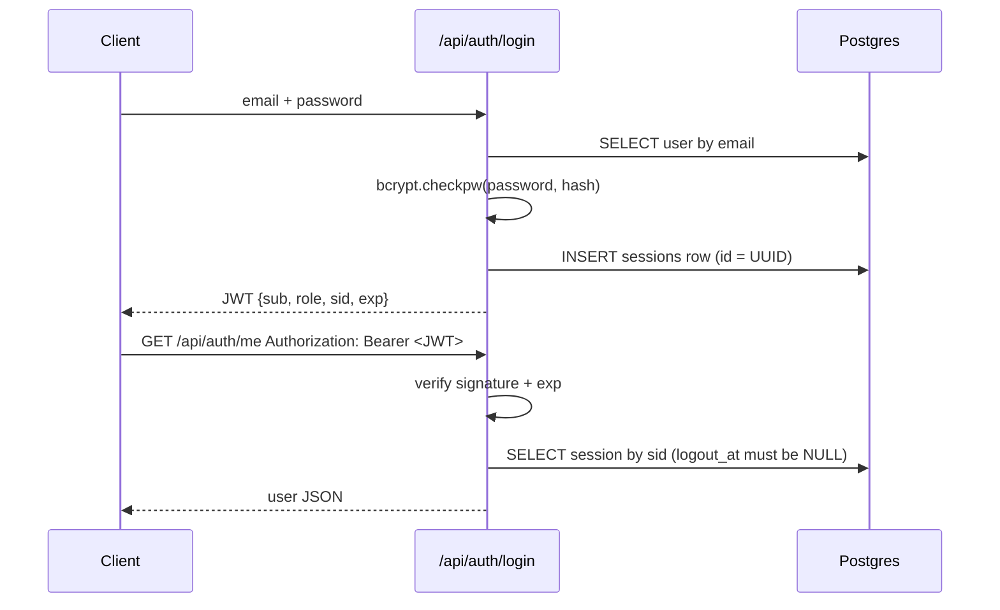
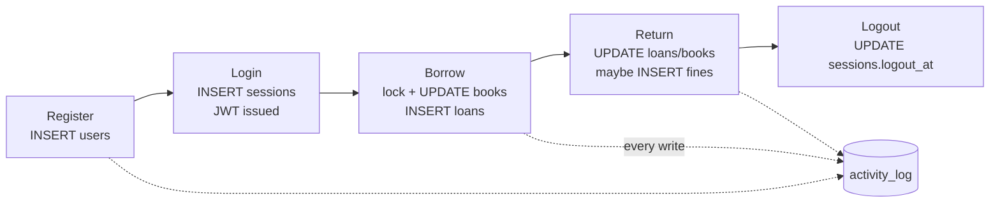

# Reading Room: Web Development Learning Guide

*A hands-on walkthrough of REST, CRUD, auth/JWT and PostgreSQL, using this project's real code.*

| | |
|:--|:--|
| **Project** | Reading Room LMS (FastAPI + SQLAlchemy + PostgreSQL + React) |
| **For** | Intern onboarding: learn by running, reading and querying |
| **Written** | 2026-10-09 |
| **Evidence** | Every response and table below was captured from the live local API and DB on 2026-10-09 |

---

## 0. How to use this guide

Each lesson follows the same loop:

```
 RUN a request  ──►  SEE the response  ──►  QUERY the DB row  ──►  READ the code that did it
```

You need **two terminals** (Git Bash) and a browser:

| Terminal | Purpose | Command |
|---|---|---|
| T1 | API server (leave running) | `./backend/run.sh` from the repo root |
| T2 | Database shell | `psql -h localhost -p 5433 -U lms -d lms` (password: `lms_dev_password`) |
| Browser | Click-to-test API | http://127.0.0.1:8000/docs |

> **Gotcha:** this app's Postgres runs inside **Docker** (container `lms-postgres`) on port **5433**.
> The Postgres you installed on Windows is probably on 5432 and is a *different server*.
> Your `psql` client works fine against the container. If `psql` isn't on PATH, use:
> `docker exec -it lms-postgres psql -U lms -d lms`

### Demo logins (from README.md)

| Email | Password | Role |
|---|---|---|
| librarian@library.dev | Librarian@123 | librarian |
| asha@library.dev | Student@123 | student |
| ravi@library.dev | Student@123 | student |
| meera@library.dev | Student@123 | student |
| kiran@library.dev | Student@123 | student |

> README describes Ravi as "needs approval" and Meera as "blocked". Trust is computed from loan
> history *relative to today*, so these stories drift as dates pass. On 2026-10-09 the live API
> returned Ravi = 86 (instant) and Meera = 60 (approval). Always check `GET /api/auth/me/trust`
> rather than trusting the README text.

---

## 1. The big picture

### 1.1 One request, top to bottom

```
  Browser (React)  /  curl  /  Swagger
        │   HTTP request:  POST /api/auth/login   body: {"email":..,"password":..}
        ▼
  app/main.py ............ creates FastAPI app, mounts all routers under /api,
        │                  turns ServiceError into {"detail": ...} JSON
        ▼
  app/routers/*.py ....... HTTP layer: path, method, status code, who-is-calling
        │   ├── app/schemas.py ........ request/response SHAPES (Pydantic validation)
        │   └── app/core/security.py .. bcrypt, JWT, get_current_user, require_librarian
        ▼
  app/services/*.py ...... BUSINESS RULES (loans, trust, fines). Never imports FastAPI.
        ▼
  app/models.py .......... Python classes = Postgres tables (SQLAlchemy ORM)
        ▼
  app/db.py .............. one DB session per request, always closed afterwards
        ▼
  PostgreSQL 16 (Docker :5433)
```

### 1.2 File map

| File | Layer | One-line job |
|---|---|---|
| `backend/app/main.py` | entry | Build app, CORS, error handler, `/api/health`, include routers |
| `backend/app/config.py` | config | Read `LMS_*` settings from root `.env` |
| `backend/app/db.py` | data | Engine + `get_db()` per-request session |
| `backend/app/models.py` | data | Tables: users, categories, books, loans, fines, sessions, activity_log |
| `backend/app/schemas.py` | HTTP | `...In` = what clients send, `...Out` = what we return |
| `backend/app/core/security.py` | auth | Hash/verify passwords, create/decode JWT, role guards |
| `backend/app/routers/auth.py` | HTTP | register, login, logout, me, sessions, trust |
| `backend/app/routers/catalog.py` | HTTP | categories + books CRUD, search |
| `backend/app/routers/loans.py` | HTTP | borrow, return, approve, reject, fines |
| `backend/app/services/loan_service.py` | rules | Borrow/approve/reject/return logic + locking |
| `backend/app/services/trust_service.py` | rules | Trust score, computed on demand |
| `backend/app/services/activity.py` | rules | Audit-log row in the same transaction |
| `backend/alembic/versions/*.py` | schema | Migrations that create/alter tables |
| `frontend/src/api/client.js` | frontend | The single `fetch` wrapper that adds the JWT |

### 1.3 Why layers? (rule to remember)

```
routers ──► services ──► models        (arrows point ONE way)
```

| Layer | Allowed to know about | Not allowed |
|---|---|---|
| Router | HTTP, schemas, services | business rules inline (keep them thin) |
| Service | models, DB session | FastAPI, `Request`, `HTTPException` |
| Model | columns, constraints | anything else |

Payoff: `loan_service.borrow(...)` can be called from an API route, a test, or a script, with no HTTP involved.
Services raise `ServiceError(409, "...")`, and `main.py` converts it to an HTTP response.

---

## 2. REST in 2 minutes

| Verb | Meaning | CRUD | Example in this project |
|---|---|---|---|
| `GET` | read | **R** | `GET /api/categories` |
| `POST` | create / action | **C** | `POST /api/categories`, `POST /api/loans` |
| `PUT` | replace / update | **U** | `PUT /api/categories/{id}` |
| `DELETE` | remove | **D** | `DELETE /api/categories/{id}` |

### Status codes you will actually see here

| Code | Meaning | Observed when |
|---|---|---|
| 200 | OK | `GET /auth/me` with valid token |
| 201 | Created | register, create category, borrow |
| 204 | No Content | logout, delete category |
| 401 | Not authenticated | no token, bad password, logged-out token |
| 403 | Forbidden (logged in, not allowed) | student creating a category; librarian borrowing |
| 404 | Not found | updating a deleted category |
| 409 | Conflict with existing data | duplicate email, duplicate category, borrowing a book twice |
| 422 | Validation failed | empty name, bad email, short password |

**401 vs 403:** 401 = "I don't know who you are". 403 = "I know who you are, and you can't do this".

---

## 3. Lesson 1: start the API and write your first row (CREATE)

### Steps

```bash
# T1
./backend/run.sh
# watch for: Starting PostgreSQL -> Applying migrations -> Seeding -> Uvicorn running on :8000

# T2 (or a third terminal)
curl -s http://127.0.0.1:8000/api/health
```

**Expected:**
```json
{"status":"ok","database":"ok"}
```

Register a user (Swagger: `POST /api/auth/register` → Try it out, or curl):

```bash
curl -s -X POST http://127.0.0.1:8000/api/auth/register \
  -H 'Content-Type: application/json' \
  -d '{"name":"Ranjith Test","email":"ranjith.guide@test.dev","password":"Test@1234"}'
```

**Actual response (201):**
```json
{"id":7,"name":"Ranjith Test","email":"ranjith.guide@test.dev","role":"student","created_at":"2026-10-09T12:32:24.628134Z"}
```

> Use your own email; the one above is taken now. Same request again returns:
> `{"detail":"Email already registered"}` **[409]**

### Find the row in Postgres

```sql
SELECT id, name, email, role, left(password_hash,20)||'...' AS password_hash
FROM users WHERE email = 'ranjith.guide@test.dev';
```

```
 id |     name     |         email          |  role   |      password_hash
----+--------------+------------------------+---------+-------------------------
  7 | Ranjith Test | ranjith.guide@test.dev | student | $2b$12$BypSN5RNZsB5v...
```

### What happened (code: `routers/auth.py :: register`)

```
Request JSON
   │
   ▼  schemas.RegisterIn  ── validates name/email/password (422 if bad)
   ▼  email.lower()
   ▼  SELECT ... WHERE email = ?        ── exists? → 409
   ▼  User(role="student", password_hash=bcrypt(password))
   ▼  db.add(user); db.flush()          ── INSERT sent, Postgres returns id=7
   ▼  activity.log(... "user.registered")   ── second INSERT, same transaction
   ▼  db.commit()                       ── both rows become permanent together
   ▼  response_model=UserOut            ── strips password_hash from the reply
```

| Code line | What you can verify |
|---|---|
| `email = body.email.lower()` | stored email is lowercase |
| `role="student"` | self-registration can never create a librarian |
| `hash_password(...)` | `password_hash` starts `$2b$12$` = bcrypt, cost 12 |
| `db.flush()` | `user.id` exists *before* commit, so the audit log can use it |
| `db.commit()` | one transaction: user + audit row, or neither |
| `response_model=schemas.UserOut` | no password field in the JSON reply |

### Exercise 1.1: break validation on purpose

```bash
curl -s -X POST http://127.0.0.1:8000/api/auth/register -H 'Content-Type: application/json' \
  -d '{"name":"","email":"notanemail","password":"1"}'
```

<details><summary>Answer</summary>

**422**, and Pydantic reports *all three* problems at once, with `loc` pointing at the field:

```
name     -> String should have at least 2 characters
email    -> value is not a valid email address: An email address must have an @-sign.
password -> String should have at least 8 characters
```
Your route function never even runs: validation happens before it.
</details>

---

## 4. Lesson 2: authentication and JWT

### 4.1 The login and request flow



Plain-text version:

```
login ──► check bcrypt ──► INSERT sessions row ──► sign JWT(sub, role, sid, exp) ──► client stores it
every request ──► "Authorization: Bearer <jwt>" ──► decode+verify ──► sessions row still open? ──► user
logout ──► UPDATE sessions SET logout_at = now() ──► same JWT now rejected
```

### 4.2 Run it

```bash
curl -s -X POST http://127.0.0.1:8000/api/auth/login -H 'Content-Type: application/json' \
  -d '{"email":"ranjith.guide@test.dev","password":"Test@1234"}'
```

**Actual response (trimmed):**
```json
{
  "access_token": "eyJhbGciOiJIUzI1NiIsInR5cCI6IkpXVCJ9.eyJzdWIiOiI3Iiwicm9sZSI6InN0dWRlbnQiLCJzaWQiOiJjYzRi....Bk9qw2ju...",
  "token_type": "bearer",
  "user": {"id":7,"name":"Ranjith Test","email":"ranjith.guide@test.dev","role":"student", "...": "..."},
  "previous_session": null
}
```

Wrong password → `{"detail":"Wrong email or password"}` **[401]**. The message is the same for
"no such email" and "wrong password", so an attacker can't use it to find which emails are registered.

### 4.3 Anatomy of the JWT

A JWT is three base64 parts joined by dots: `HEADER.PAYLOAD.SIGNATURE`.

| Part | Decoded content (actual) | Notes |
|---|---|---|
| Header | `{"alg":"HS256","typ":"JWT"}` | HMAC-SHA256 with `LMS_JWT_SECRET` |
| Payload | `{"sub":"7","role":"student","sid":"cc4b6b78-...","exp":1791577946}` | **readable by anyone**, never put secrets here |
| Signature | `Bk9qw2ju...` | proves the server made it; editing the payload breaks it |

| Claim | Set in `create_token` as | Used for |
|---|---|---|
| `sub` | `str(user.id)` | who |
| `role` | `user.role` | convenience for the client (server re-checks the DB user) |
| `sid` | sessions row UUID | makes logout real |
| `exp` | now + `jwt_expire_minutes` (default 480 = 8 h) | expiry; PyJWT rejects automatically |

**Try it:** paste your token into https://jwt.io. You can read the payload but can't forge a valid signature without the secret.

### 4.4 Using the token

```bash
TOKEN=<paste access_token>
curl -s http://127.0.0.1:8000/api/auth/me                                  # no header
curl -s http://127.0.0.1:8000/api/auth/me -H "Authorization: Bearer $TOKEN"
curl -s -X POST http://127.0.0.1:8000/api/auth/logout -H "Authorization: Bearer $TOKEN"
curl -s http://127.0.0.1:8000/api/auth/me -H "Authorization: Bearer $TOKEN"  # same token again
```

| Call | Actual result |
|---|---|
| `/me` without header | `{"detail":"Not authenticated"}` **401** |
| `/me` with token | user JSON **200** |
| `/logout` | empty body **204** |
| `/me` with the **same** token after logout | `{"detail":"Session has ended, please log in again"}` **401** |

### 4.5 The DB side of sessions

```sql
SELECT id, user_id, login_at, logout_at FROM sessions WHERE user_id = 7 ORDER BY login_at;
```
```
                  id                  | user_id |           login_at            |          logout_at
--------------------------------------+---------+-------------------------------+------------------------------
 cc4b6b78-faa5-4c44-9190-ab0d538d9849 |       7 | 2026-10-09 12:32:25.95357+00  | 2026-10-09 12:32:27.67078+00
 27a69fc4-937e-494f-92f3-a39d648f6a5a |       7 | 2026-10-09 12:32:43.535494+00 |
```
The first row's `id` equals the `sid` inside the JWT. Logout filled `logout_at`.

### 4.6 The dependency chain (code: `core/security.py`)

FastAPI "dependencies" are functions a route declares with `Depends(...)`. They run first and pass their result in.

```
bearer (read "Authorization: Bearer ...")
   └─► get_current_session   decode JWT → sid → sessions row → reject if logout_at set   (401)
         └─► get_current_user      sessions.user_id → users row                          (401)
               └─► require_librarian    role != 'librarian' → 403
```

| Route uses | Who gets in |
|---|---|
| nothing | everyone (`/auth/register`, `/auth/login`, `/api/health`) |
| `Depends(get_current_user)` | any logged-in user |
| `Depends(require_librarian)` | librarians only |

### Exercise 2.1: why store sessions if JWT is "stateless"?

<details><summary>Answer</summary>

A plain JWT stays valid until `exp`; the server has no way to "un-issue" it. Here every request
also looks up the `sessions` row by `sid`. Logout sets `logout_at`, so the token dies immediately.
The trade-off is one small DB read per request, in exchange for logout that actually works and a
login history (`GET /api/auth/me/sessions`).
</details>

### Exercise 2.2: why bcrypt and not SHA-256?

<details><summary>Answer</summary>

bcrypt is deliberately slow (cost factor `12` in `$2b$12$`) and adds a random salt to each hash,
so the same password hashes differently for every user and brute-forcing is expensive. SHA-256 is
built to be fast, which is exactly what you don't want for passwords.
</details>

---

## 5. Lesson 3: full CRUD with role checks (categories)

Code: `backend/app/routers/catalog.py`. Log in as the librarian first and use that token as `$L`.

```bash
L=<librarian access_token>
B=http://127.0.0.1:8000/api
```

| # | Operation | Request | Actual result |
|---|---|---|---|
| C | Create | `POST $B/categories` `{"name":"Guide Test","description":"made for the learning guide"}` | `{"id":11,"name":"Guide Test",...,"book_count":0}` **201** |
| C✗ | Duplicate (different case) | `POST` `{"name":"guide test"}` | `Category already exists` **409** |
| R | Read list | `GET $B/categories` | `[{"id":4,"name":"Classic Literature",...,"book_count":8}, ...]` **200** |
| U | Update | `PUT $B/categories/11` `{"name":"Guide Test Renamed","description":"updated"}` | updated JSON **200** |
| D✗ | Delete non-empty | `DELETE $B/categories/1` | `Category still has 8 book(s); move or delete them first` **409** |
| D | Delete | `DELETE $B/categories/11` | empty **204** |
| U✗ | Update deleted | `PUT $B/categories/11` `{"name":"Ghost"}` | `Category not found` **404** |
| ✗ | As a **student** | `POST $B/categories` | `Librarian access required` **403** |

Curl template:
```bash
curl -s -X POST $B/categories -H 'Content-Type: application/json' -H "Authorization: Bearer $L" \
  -d '{"name":"Guide Test","description":"made for the learning guide"}'
```

### SQL each step runs (roughly)

| Operation | SQL |
|---|---|
| duplicate check | `SELECT ... FROM categories WHERE lower(name) = lower('Guide Test')` |
| create | `INSERT INTO categories (name, description) VALUES (...) RETURNING id` |
| read | `SELECT categories.*, count(books.id) FROM categories LEFT OUTER JOIN books ... GROUP BY ...` |
| update | `UPDATE categories SET name=..., description=... WHERE id = 11` |
| delete guard | `SELECT count(*) FROM books WHERE category_id = 1` |
| delete | `DELETE FROM categories WHERE id = 11` |

### Audit trail of what you just did

```sql
SELECT id, user_id, action, entity, entity_id, details
FROM activity_log WHERE action LIKE 'category.%' ORDER BY id DESC LIMIT 3;
```
```
 id  | user_id |      action      |  entity  | entity_id |            details
-----+---------+------------------+----------+-----------+--------------------------------
 199 |       1 | category.deleted | category |        11 | {"name": "Guide Test Renamed"}
 198 |       1 | category.updated | category |        11 | {"name": "Guide Test Renamed"}
 197 |       1 | category.created | category |        11 | {"name": "Guide Test"}
```

### Exercise 3.1: I sent `PUT /categories/11` with `{"name":"x"}` and got 422, not 404. Why?

<details><summary>Answer</summary>

Order of checks: **schema validation first** (`name` needs ≥ 2 characters → 422), then the route
body runs `_get_category` (→ 404). Send a valid name and you get the 404.
</details>

### Exercise 3.2: why refuse to delete a category that has books?

<details><summary>Answer</summary>

`books.category_id` is a foreign key to `categories.id`. Deleting the category would either fail
at the DB level or leave books pointing at nothing. The route checks first and returns a readable
409 instead of a raw database error.
</details>

### Exercise 3.3: what extra thing happens when a category is *renamed*?

<details><summary>Answer</summary>

`update_category` calls `embed_after_change(...)` for every book in that category, because the
category name is part of each book's AI embedding text. With `LMS_AI_PROVIDER=none` this does no
network calls.
</details>

---

## 6. Lesson 4: how tables get created (models and migrations)

```
models.py (Python classes)  ──alembic revision --autogenerate──►  alembic/versions/xxxx.py
                                                                         │
                                                       alembic upgrade head
                                                                         ▼
                                                    Postgres tables + alembic_version row
```

| Migration file | What it adds |
|---|---|
| `2a1d1455f9c2_initial_schema.py` | all core tables |
| `3b7e0c1d2f4a_book_embeddings.py` | pgvector embedding columns on books |

### Look at it in psql

```sql
\dt
SELECT * FROM alembic_version;
\d books
```
```
 activity_log | alembic_version | books | categories | fines | loans | sessions | users

 version_num
--------------
 3b7e0c1d2f4a          ← the DB is at the latest ("head") migration
```

### Model → table cheat sheet (`models.py`)

| Python | Postgres result |
|---|---|
| `id: Mapped[int] = mapped_column(primary_key=True)` | `id SERIAL PRIMARY KEY` |
| `String(255)`, `unique=True, index=True` | `VARCHAR(255)` + unique index |
| `ForeignKey("categories.id")` | FK constraint |
| `server_default=func.now()` | `DEFAULT now()` (set by Postgres, not Python) |
| `CheckConstraint("available_copies >= 0")` | DB refuses invalid rows itself |
| `Computed("setweight(to_tsvector(...))", persisted=True)` | generated column `books.search`; never write to it |

### Entity relationships

```
users 1───* loans *───1 books *───1 categories
  │           │
  │           └──0..1 fines
  ├──* sessions        (one row per login)
  └──* activity_log    (append-only audit)
```

**Rules:** never edit a migration that's already applied; make a new one. Tests don't use Alembic:
they build the schema from `Base.metadata` in the separate `lms_test` database.

### Exercise 4.1: list the CHECK constraints on books

```sql
SELECT conname, pg_get_constraintdef(oid) FROM pg_constraint
WHERE conrelid = 'books'::regclass AND contype = 'c';
```
<details><summary>Answer</summary>

```
 ck_books_available_le_total | CHECK ((available_copies <= total_copies))
 ck_books_available_nonneg   | CHECK ((available_copies >= 0))
```
Even if the Python code had a bug, Postgres would never allow negative stock.
</details>

---

## 7. Lesson 5: business logic, transactions and concurrency (loans)

Code: `backend/app/services/loan_service.py` and `trust_service.py`.

### 7.1 Trust score (computed every time, never stored)

```
score = 100 − 10·late_returns − 15·unpaid_fines − 25·(anything overdue now) + 2·on_time_returns
clamp to 0..100
```

| Score | Level | What borrowing does |
|---|---|---|
| ≥ 70 | `instant` | loan created as `borrowed`, due in 14 days |
| 40–69 | `approval` | loan created as `pending`; librarian approves/rejects |
| < 40 | `blocked` | 403 |

Actual trust responses (2026-10-09):

| User | score | level | reasons |
|---|---|---|---|
| new user (id 7) | 100 | instant | New reader with a clean record |
| ravi | 86 | instant | 2 late return(s) (−20), 3 on-time return(s) (+6) |
| meera | 60 | approval | (borrow returned `trust_score: 60`) |

### 7.2 Loan state machine

```
                 trust ≥ 70
   borrow ───────────────────────────►  borrowed ──return──► returned  (+ fine if late)
     │                                     ▲
     │ 40 ≤ trust < 70                     │ approve (librarian)
     └──────────► pending ─────────────────┘
                     │
                     └── reject (librarian) ──► rejected  (copy put back)
```
Allowed values are enforced by `CHECK (status IN ('pending','borrowed','returned','rejected'))`.

### 7.3 Run it

```bash
S=<your student token>
curl -s "$B/books?available=true" -H "Authorization: Bearer $S"          # pick a book id
curl -s -X POST $B/loans -H 'Content-Type: application/json' -H "Authorization: Bearer $S" -d '{"book_id":26}'
```

| Step | Actual result |
|---|---|
| borrow book 26 ("1984") | `"status":"borrowed"`, `"due_at":"2026-10-23..."`, `"message":"Borrowed! Due back on 23 Oct 2026."` **201** |
| borrow same book again | `You already have this book (or a pending request for it)` **409** |
| `POST $B/loans/25/return` | `"returned_at":"2026-10-09..."`, `"days_overdue":0` **200** |
| return again | `Loan is returned, not borrowed` **409** |
| librarian tries to borrow | `Only students can borrow books` **403** |
| trust after on-time return | `"reasons":["1 on-time return(s) (+2)"]` (still 100: clamped) |

Watch the copy count move in psql while you do it:

```sql
SELECT id, title, total_copies, available_copies FROM books WHERE id = 26;
-- before borrow: 2   after borrow: 1   after return: 2
```

### 7.4 Inside `borrow()`: one transaction, in order

| # | Code | Why |
|---|---|---|
| 1 | `role != "student"` → 403 | librarians don't borrow |
| 2 | `SELECT users.id ... FOR UPDATE` | **locks this student's row**: two parallel clicks queue up (fix for LMS-BUG-006) |
| 3 | active loans check | no duplicates, max 3 active |
| 4 | `trust_service.compute(...)` | decide instant / approval / blocked |
| 5 | `_take_copy`: `UPDATE books SET available_copies = available_copies − 1 WHERE id=? AND available_copies > 0` | **atomic**; if 0 rows updated → 409 "No copies available" |
| 6 | `INSERT loans` (`borrowed` or `pending`) | a pending request already reserves its copy |
| 7 | `activity.log(...)` + `db.commit()` | all or nothing |

### 7.5 Why the atomic UPDATE matters (the race)

```
Naive (BROKEN)                               This project
--------------                               ------------
A: SELECT available → 1                      A: UPDATE ... WHERE available > 0  → 1 row ✓
B: SELECT available → 1                      B: UPDATE ... WHERE available > 0  → 0 rows → 409
A: UPDATE set 0                              (Postgres row lock serialises A and B)
B: UPDATE set 0   ← two loans, one copy!
```
Proven by tests: `test_concurrent_borrow_of_last_copy_issues_it_once` and
`test_concurrent_borrows_by_one_student_respect_loan_limit` in `backend/tests/test_loans_fines_trust.py`.

### 7.6 Late return → fine (same transaction)

```
days_late = return_date − due_date
if days_late > 0:  INSERT fines(amount = days_late × fine_per_day)   -- default 5
```

### Exercise 5.1: what if two librarians approve the same pending loan at the same time?

<details><summary>Answer</summary>

`_get_loan` uses `SELECT ... FOR UPDATE`, so the second librarian waits. When it continues, the loan
is already `borrowed`, so it gets `Loan is borrowed, not pending` **409**.
</details>

### Exercise 5.2: why compute trust instead of storing a `trust_score` column?

<details><summary>Answer</summary>

A stored score goes stale: a book becomes overdue at midnight without any write happening.
Computing it from `loans` and `fines` every time means it's always correct for "now".
</details>

---

## 8. Lesson 6: the frontend side

```
React page ──► api('/loans', {method:'POST', body}) ──► fetch('/api/loans')
                                     │                        │
              adds  Authorization: Bearer <token from localStorage 'lms_token'>
                                                              ▼
                     Vite dev server (:5173) proxies /api ──► FastAPI (:8000)
```

| File | Job |
|---|---|
| `frontend/src/api/client.js` | only place that calls `fetch`; adds token; 204 → `null`; turns `detail` into an error message; on 401 → logout |
| `frontend/src/context/AuthContext.jsx` | holds the current user |
| `frontend/src/App.jsx` | different route table for student vs librarian |
| `frontend/src/pages/student/StudentPages.jsx`, `pages/librarian/LibrarianPages.jsx` | screens |

The key lines from `client.js`:
```js
const token = tokenStore.get()
if (token) headers.Authorization = `Bearer ${token}`
...
if (res.status === 401 && token) onUnauthorized()      // expired / logged-out token
const message = Array.isArray(detail)                    // 422 list → "field: msg, ..."
  ? detail.map((d) => `${d.loc?.at(-1)}: ${d.msg}`).join(', ')
  : detail || `Request failed (${res.status})`
```

**Try it:** run `./frontend/run.sh`, open http://localhost:5173, then open DevTools → Network.
Log in and click around. Every request you see is one of the curl calls from this guide.
In DevTools → Application → Local Storage you'll find `lms_token`.

---

## 9. Full lifecycle, end to end



The actual audit trail of the test user's whole journey:
```
 id  | user_id |      action      | entity | entity_id |            details
-----+---------+------------------+--------+-----------+-------------------------------
 204 |       7 | loan.returned    | loan   |        25 | {"days_late": 0}
 203 |       7 | auth.login       | user   |         7 | {}
 201 |       7 | loan.borrowed    | loan   |        25 | {"trust": 100, "book_id": 26}
 200 |       7 | auth.login       | user   |         7 | {}
 195 |       7 | auth.logout      | user   |         7 | {}
 194 |       7 | auth.login       | user   |         7 | {}
 193 |       7 | user.registered  | user   |         7 | {}
```

---

## 10. Useful SQL for exploring

```sql
\dt                                   -- tables
\d loans                              -- columns + constraints of one table
SELECT id, email, role FROM users;
SELECT status, count(*) FROM loans GROUP BY status;
SELECT b.title, b.available_copies, b.total_copies FROM books b ORDER BY b.title LIMIT 10;
SELECT u.email, f.days_late, f.amount, f.status FROM fines f JOIN users u ON u.id = f.user_id;
SELECT * FROM activity_log ORDER BY id DESC LIMIT 10;
SELECT title FROM books WHERE search @@ websearch_to_tsquery('english', 'dystopia');
```

**Read only while learning.** Changing rows by hand skips the business rules, so prefer going through the API.
To reset demo data: `cd backend && .venv/Scripts/python -m scripts.seed --reset` (wipes and re-seeds).

---

## 11. Self-check quiz

| # | Question | Answer |
|---|---|---|
| 1 | Where is a new endpoint's URL path defined? | In a router (`@router.post("/...")`), with the `/api` prefix added in `main.py` |
| 2 | Where should "max 3 active loans" live? | `services/loan_service.py`, not the router |
| 3 | What turns `ServiceError(409, msg)` into JSON? | `service_error_handler` in `main.py` |
| 4 | What keeps `password_hash` out of responses? | `response_model=schemas.UserOut` |
| 5 | Which claim links a JWT to logout? | `sid` (sessions row id) |
| 6 | 401 or 403 for a student calling `POST /categories`? | 403 |
| 7 | Why `flush()` before `commit()` in register? | to get `user.id` for the audit row inside one transaction |
| 8 | What stops stock going negative even if code is buggy? | `CHECK (available_copies >= 0)` in Postgres |
| 9 | How do you change the DB schema? | edit `models.py`, then `alembic revision --autogenerate`, review it, then `alembic upgrade head` |
| 10 | What does the app do with AI turned off? | keyword search + templated answers (`LMS_AI_PROVIDER=none`) |

---

## 12. Next steps (do these yourself)

1. Run the test suite: `./backend/run.sh --test`. Then read one test in `tests/test_api.py` and match it to a curl call above.
2. Trace `GET /api/books?q=dystopia` from `catalog.py :: list_books` down to the `search @@` SQL.
3. Read `docs/BUG_FIXES.md` LMS-BUG-006 next to section 7.4 above.
4. Design on paper (no code yet): which layers and files would a "renew loan" feature touch? Compare with how `approve` is built.

---

## References

| | |
|:--|:--|
| **FastAPI** | dependencies, response models: https://fastapi.tiangolo.com |
| **SQLAlchemy 2.0** | ORM, sessions, `with_for_update`: https://docs.sqlalchemy.org |
| **Alembic** | migrations: https://alembic.sqlalchemy.org |
| **Pydantic** | validation: https://docs.pydantic.dev |
| **JWT** | RFC 7519 / inspector: https://jwt.io |
| **PostgreSQL** | row locks, CHECK, full-text search: https://www.postgresql.org/docs/16/ |
| **This repo** | `docs/ARCHITECTURE.md`, `docs/API.md`, `docs/BUG_FIXES.md` |
